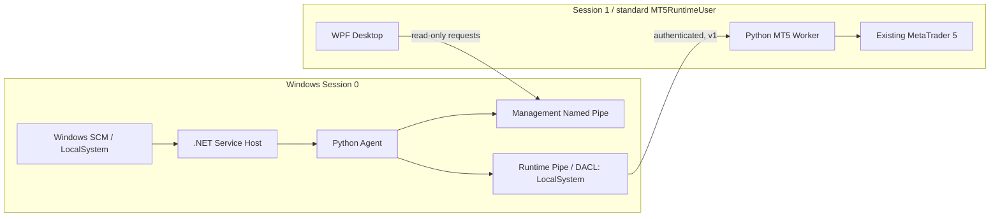

# MT5Agent v0.1.5 Release Readiness

**Status: PARTIAL — Windows 10 live integration and the earlier clean 15-minute soak passed, but the installed Pipeline #84 artifact still has a verified Worker Session reporting defect. A source fix exists. A protected LocalSystem CI smoke mechanism and stricter health validation are now implemented in the working tree, but have not yet run in Windows CI. No replacement Installer has been produced.** Pipeline success does not prove correct installation or stable runtime behavior. This is an internal candidate assessment, not release approval.

## Architecture and lifecycle

The Service starts the Agent in Session 0. The Management pipe serves only the
configured callers and read-only operations. The Worker and existing MT5
terminal run under the standard interactive runtime account. Runtime settings
are machine-local; the Worker pipe authorizes the actual LocalSystem Service
identity. No MT5 installation, profile, account or credential is managed by the
Installer.

## Acceptance evidence

| Gate | Result | Evidence / limitation |
|---|---|---|
| CI baseline | **PASS** | Pipeline #84 passed 14/14 jobs; Build #862 and Verify #863; commit `91d5f6b47181375dc76975ebf61081746d0d136b`. |
| Pipeline #84 artifact | **PASS** | Installer/manifest/sidecar match; Ubuntu and Windows SHA-256 `2606c179c2744cddda54915140f264029adac1a35c9b372596a586192d1927de`; 9 installed components match Job #862. |
| Installer exit contract | **NOT RECORDED** | Product Owner manually installed the artifact; the Installer PID and numeric Exit Code were not captured. We did not rerun Pipeline #84 Setup. |
| Service registration / Session 0 | **PASS** | `MT5Agent` Automatic, LocalSystem, Running. Initially PID 4088 (Agent 7236/7016), after controlled restart PID 2368 (Agent 8092/6544), and after VM power-on PID 2940 (Agent 3560/3696) were all observed in Session 0. |
| SCM recovery | **PASS** | Live readback: restart at 5 s and 15 s, 86,400 s reset, non-crash failures enabled (`TRUE`). |
| Runtime identity / pipe ACL | **PASS for tested boundary** | RuntimePrincipal is standard `MT5RuntimeUser`; ControlPrincipal migrated reversibly to LocalSystem using the packaged supported script. Administrator and RuntimeUser negative access attempts were denied; a LocalSystem health probe succeeded. |
| Worker / MT5 health | **PASS for initial Worker-only soak** | 32/32 health samples over 15m34s; Worker PID 6852 and MT5 PID 7944 stayed in Session 1, one Worker process, connected/initialized, terminal build 6249. Safe version and symbol-count reads passed. |
| Agent↔Worker↔MT5 | **PASS for tested live path** | The original clean soak passed 32/32 over 15m35s. After VM power-on, a second soak passed 32/32 fresh `MT5_CONNECTED` samples over 15m34s. Current Worker PID 6276 and terminal PID 7308 remained in Session 1 under `MT5RuntimeUser`, with the terminal parented by the Worker. Safe terminal version and symbol-count reads passed earlier. The earlier reconnect-exhausted interval after Worker API shutdown/restart is retained as a separate non-clean run and risk. |
| Management authorization | **PASS for tested boundary** | Authorized Administrator `status.get` succeeded; RuntimeUser access to Management and Administrator access to the Worker pipe were denied with WinError 5. The Service's LocalSystem identity was authorized for Worker IPC/health, not Management `status.get`. Contract probes as LocalSystem returned structured `TIMEOUT` and `UNSUPPORTED_OPERATION` for `service.restart`. Unsupported Worker `order_send` was rejected as `IPC_UNSUPPORTED_OPERATION`; no trade occurred. |
| Service restart preservation | **PASS** | Controlled Service restart returned to Running as LocalSystem/Automatic, with a fresh connected Management response. Service PID changed 4088→2368; Worker PID 7032 and MT5 PID 7944 were preserved. |
| Health contract | **FAIL in installed artifact; source fix pending deployment** | Installed Pipeline #84 reports `worker_session_id: null` despite live Worker Session 1. Regression fix is committed as `a5b8a6f4f872af019450e9f94100edda41083899`. Pipelines #85–#87 did not produce a replacement artifact because the configured package mirror timed out fetching Pillow. |
| CI for health fix | **FAIL — infrastructure** | Pipeline #85 Windows tests and WPF Management passed; its Windows and Worker builds failed on mirror timeouts. Pipelines #86 and #87 passed Windows tests, WPF Management, and Desktop package verification; Linux tests failed before test execution on the same mirror timeout, so downstream build/Installer jobs were skipped. No quality gate or package source was changed. |
| Pipeline #88 on commit `1c746bc39ecbb7b734169d9f12eb0733d5bc9b94` | **FAIL — CI identity precondition** | Windows validation, Desktop build/package validation, Linux/Windows/WPF tests, both builds, `smoke:control-plane`, `smoke:invalid-configuration`, and Desktop package verification passed. `smoke:mt5-runtime` failed closed at `Assert-WorkerTaskAndPreflight`: the self-hosted runner service runs as `WIN10-MT5-RUNNE\Administrator`, while the installed runtime policy sets `ControlPrincipal=NT AUTHORITY\SYSTEM`. The Session 0 control-caller SID check rejected the mismatch before runtime IPC. Windows packaging and both Installer jobs were skipped; no new artifact exists. Do not broaden the Worker pipe ACL or change ControlPrincipal to make this smoke pass. The CI smoke needs a supported way to run its control client as the configured Session 0 service identity. |
| Pipeline #89 on commit `27f994b7cf38c747831f6ae64147a1d508607bf3` | **FAIL — same identity precondition** | Doc-only pipeline repeated the failed Administrator-versus-LocalSystem check in `smoke:mt5-runtime` Job #929; no artifact was produced. This is the last observed Pipeline baseline. |
| Pipeline #90 on commit `caa7cfc20ebd374a400c29d511b56c7cc6d72819` | **FAIL — regression fixture mismatch** | Windows Job #937 ran 344 passed / 2 skipped / 1 failed. New package validation correctly requires `worker_session_id` to match the authenticated Worker session; the legacy isolated `test_package_preserves_single_validated_binary` fixture omitted that newly required field. The WPF Management job passed. Runtime smoke and packaging were not reached. Updated the fixture and added malformed/missing Session ID rejection cases before the next Pipeline. |
| Pipeline #91 on commit `479575e0f1bb25c4e3946a3c39f641810d38466f` | **FAIL — ACL preflight false positive** | Linux, Windows, WPF, Agent/Worker builds and degraded control-plane smoke passed; Windows test Job #951 passed. Live smoke Job #957 failed before creating the Scheduled Task because a composite Windows rights bitmask interpreted the installed `BUILTIN\Users:(RX)` ACE as writeable. A read-only ACL inspection (`icacls C:\Program Files\MT5Agent`) confirmed Users has only Read & Execute and TrustedInstaller/System/Admin have Full Control. The ACL was not changed. Replaced the overlapping composite mask with per-right checks and added a regression guard; retry pending. |
| Pipeline #92 on commit `1b96f2e4fd90e4dfdee07fe471db24d8f4d7edad` | **FAIL — inherited ACE translation** | All prior validation/test/build jobs passed. Live smoke Job #971 failed before Scheduled Task creation while translating the `CREATOR OWNER` inheritance-only ACE. No ACL or installed component changed. The coordinator now ignores `InheritOnly` ACEs when checking the root's effective access and fails closed if any other effective mutating ACE cannot be resolved. Another real Windows run is required. |
| Protected LocalSystem smoke implementation | **NOT TESTED on Windows yet** | Working tree adds a one-shot, fixed-entrypoint Scheduled Task running as SYSTEM in Session 0. It requires LocalSystem ControlPrincipal, a distinct RuntimePrincipal, a denied Administrator pipe probe, protected Program Files staging, commit/build/test hashes, bounded execution, structured receipt, serialized runtime access, and owned-resource cleanup. Static contract tests are present. See [`CI_RUNTIME_SMOKE.md`](CI_RUNTIME_SMOKE.md). The next feature-branch Pipeline must validate Task Scheduler and live pipe behavior. |
| WPF Management test executable provenance | **NOT TESTED on Windows yet** | The WPF job now emits a pipeline/commit/size/SHA-256 receipt; the privileged task validates that receipt and copied executable. Pending a successful Pipeline. |
| Source Worker Session health correction | **PASS in local regression; deployment pending** | The adapter accepts only positive exact integer PID/session values (rejects booleans and malformed values) and reports the authenticated Worker identity's session, not an untrusted runtime result field. Regression tests cover invalid IDs and injected health data. The installed Pipeline #84 executable is unchanged. |
| Local Python regression for current changes | **PASS with host-only exclusion** | `pytest`: 302 passed, 37 skipped; `tests/test_windows_worker_launcher.py` was excluded because `pywin32` is unavailable on Ubuntu. Windows CI must execute the complete configured suite. |
| Logs / event review | **PASS for observed window** | One informational MT5Agent Application event and one SCM Information event after installation/configuration; no matching .NET Runtime/Application Error or MT5Agent error event found. Logs redact SIDs and expose fixed messages. |
| WPF on integration runner | **NOT TESTED** | Two existing Desktop processes were observed in Session 1; neither was launched or closed by this validation. |
| Windows 11 / Server compatibility | **NOT TESTED** | Live product evidence is Windows 10 Pro x64 build 19045 only. |
| RDP/logoff, Worker-unavailable injection | **NOT TESTED** | These tests were not performed to preserve the active session and MT5 runtime. |
| Public release / signing | **BLOCKED** | Internal unsigned artifact; no release, tag, or merge to staging/main. |

Detailed live evidence is in
[`win10-mt5-runner-runtime-integration-20261013.md`](../evidence/v0.1.5/win10-mt5-runner-runtime-integration-20261013.md).
Raw evidence remains under
`C:\MT5Agent-Test\Evidence\RuntimeIntegration-Pipeline84-Install-20261013-151000\`.

## Release decision

The candidate is **not release-ready**. Pipeline #84 is the verified installed
build. After the operator powered the VMs on, the Service and Agent ran in
Session 0 alongside the existing Worker and MT5 terminal in Session 1; the
fresh 15-minute post-boot soak passed 32/32 samples. The earlier controlled
Service restart also preserved Worker and terminal PIDs. The earlier reconnect
transition remains recorded. The current artifact still omits the authenticated
Worker session number from Management health. The source fix is committed, but
Pipelines #85–#87 did not produce a new Installer because the configured
package mirror was unreachable. Pipelines #88 and #89 failed closed because the
Administrator-runner token does not match the product's LocalSystem
ControlPrincipal; package and Installer jobs were skipped. The current
working-tree implementation keeps that authentication boundary intact and
introduces a protected one-shot LocalSystem task. It has only local structural
and Python test evidence so far. Run and review a new feature-branch Pipeline
before treating it as validated. Then install the exact new verified artifact
and confirm live Management Health reports `worker_session_id=1` while the
Worker is actually in Session 1, and repeat the 15-minute soak with that binary.
Keep Windows 11, Windows Server, RDP/logoff, WPF-on-runner and public signing
gates open until real evidence exists.
