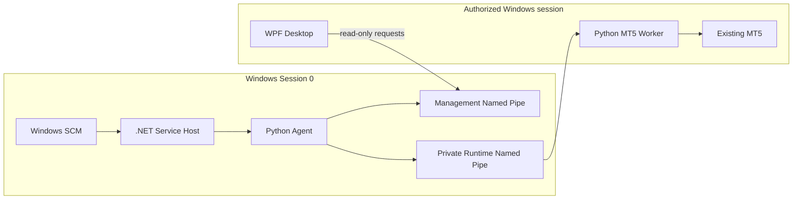

# MT5Agent v0.1.5 Release Readiness

**Status: PARTIAL — real Windows installation and core Service/Management/WPF checks passed; Worker/MT5 integration is not configured.** This is an internal candidate assessment, not release approval. A green CI pipeline is separate evidence from behavior observed on Windows.

## Architecture and lifecycle

The Service starts the Agent in Session 0. The WPF client uses a separate,
read-only Management pipe. The Worker and existing MT5 terminal must run in a
configured interactive user session. The Installer does not redistribute or
modify MT5.

## Acceptance evidence

| Gate | Result | Evidence / limitation |
|---|---|---|
| Pipeline and Windows build | **PASS** | Pipeline #82 passed 14/14 jobs for `bb7928643ed5f45ecd70afbad032d88ef833a034`; build #834, verify #835. |
| Artifact provenance and integrity | **PASS** | Pipeline #82 installer, manifest and sidecar match; Ubuntu and Windows SHA-256: `5578546e223cec3d23f8d25e78a6e0d1d62af7c0f04db13b26255b9184b39404`. Unsigned internal artifact only. |
| Installer on Windows 10 | **PASS** | One run on `WIN10-INSTALLER`, PID 4912, Exit Code 0; existing test installation was repaired, so not a clean-machine install. |
| Service registration and Session 0 startup | **PASS** | `MT5Agent` Auto/LocalSystem, correct executable; Service and Agent parent/child observed in Session 0. |
| Recovery configuration | **PASS** | Real SCM read-back: 5 s / 15 s restart actions, 24-hour reset, non-crash flag `TRUE`. |
| Service stop/restart and crash recovery | **PASS for one cycle** | New build stopped gracefully in 1.891 s, all Agent processes exited, and Service restarted in 4.641 s. After a controlled Agent termination, SCM recovered the Service with a new PID in 12.61 s and Agent restarted in Session 0. The earlier shutdown timeout during Installer upgrade came from the prior Pipeline #80 Service binary. |
| Agent process and health | **PASS with degraded runtime** | Agent answered Management requests with fresh status and `AGENT_RUNNING`; runtime accurately reports `RUNTIME_CONFIGURATION_UNAVAILABLE`, Worker disconnected and MT5 disconnected. No HTTP 8080 listener exists in the packaged Service mode. |
| Management authorization | **PASS for tested boundary** | Allowlisted Administrator `status.get` and `logs.query` succeeded. LocalSystem received `UNAUTHORIZED`; unsupported `service.restart` received `UNSUPPORTED_OPERATION`. No privileged management operation is exposed by this pipe. |
| Log and Event Log review | **PASS for observed run** | Service Host and Agent logs show clean explicit shutdown/restart; SIDs are redacted. Informational MT5Agent events observed; no .NET Runtime/Application Error event in the reviewed window. |
| Worker/MT5 | **BLOCKED — NOT CONFIGURED** | Worker binary is installed, but runtime registry values, dedicated standard runtime user and interactive Worker task are absent. MT5 is installed but not running. Provisioning requires an interactive principal and matching profile; no MT5 account or credential was changed. |
| WPF interactive smoke | **PASS** | Version 0.1.5.0 in Session 1; Runtime, Settings, Logs, Diagnostics and About opened; theme test restored preferences; app exited while Service remained Running. High-DPI variants not tested. |
| Stability / recovery soak | **PASS for observed scope** | 32 samples over 987 s; zero Service PID changes and no Agent PID-set changes. Product process count stayed three; CPU and memory ranges, zero HTTP listeners and zero relevant .NET/Application errors are recorded in the evidence report. One controlled Agent termination recovered automatically. Boot, repeated crash, RDP/logoff and high DPI remain untested. |
| Windows 11 / Server compatibility | **NOT TESTED** | Windows 10 Pro x64 build 19045 is the only live product installation platform tested here. |
| Public release / signing | **BLOCKED** | Artifact is unsigned and internal. No public release, tag or merge to staging/main was performed. |

Detailed Windows evidence is recorded in
[`pipeline82-real-install.md`](../evidence/v0.1.5/windows10-19045/pipeline82-real-install.md).
Raw evidence remains at
`C:\MT5Agent-Test\Evidence\Install-Pipeline82-Retest-20261013-100449\`.

## Recovery contract

The installer configures the Service Control Manager to restart after 5 and
15 seconds, with a 24-hour reset period and non-crash failures enabled. The
Windows 10 SCM returned `FAILURE_ACTIONS_ON_NONCRASH_FAILURES: TRUE`, which is
accepted and verified. The Pipeline #82 Agent shutdown event allowed the
Service to stop the Agent cleanly during the explicit Service lifecycle test.

## Release decision

The candidate is **not release-ready** while Worker/MT5 runtime provisioning is
absent and stability metrics remain pending. The next safe step is to provision
the dedicated non-administrator runtime principal and matching MT5 profile
through the documented secure local workflow, then validate the Worker and
safe-read MT5 health without changing trading accounts or placing orders.
After the soak result is recorded, reassess the release gates. Windows 11 and
Windows Server must remain unverified until tested on those operating systems;
the unsigned internal artifact must not be distributed publicly.
