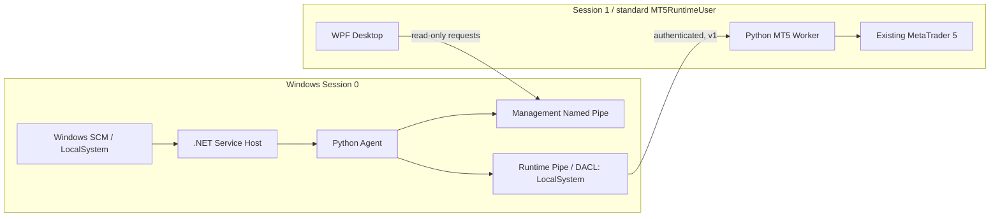

# MT5Agent v0.1.5 Release Readiness

**Status: PARTIAL — live Worker/MT5 integration is established on Windows 10, but the currently installed artifact has a verified health-reporting defect and the integrated stability run has observed a reconnect transition.** Pipeline success does not prove correct installation or stable runtime behavior. This is an internal candidate assessment, not release approval.

## Architecture and lifecycle

The Service starts the Agent in Session 0. The Management pipe serves only the
configured callers and read-only operations. The Worker and existing MT5
terminal run under the standard interactive runtime account. Runtime settings
are machine-local; the Worker pipe authorizes the actual LocalSystem Service
identity. No MT5 installation, profile, account or credential is managed by the
Installer.

## Acceptance evidence

| Gate | Result | Evidence / limitation |
|---|---|---|
| CI baseline | **PASS** | Pipeline #84 passed 14/14 jobs; Build #862 and Verify #863; commit `91d5f6b47181375dc76975ebf61081746d0d136b`. |
| Pipeline #84 artifact | **PASS** | Installer/manifest/sidecar match; Ubuntu and Windows SHA-256 `2606c179c2744cddda54915140f264029adac1a35c9b372596a586192d1927de`; 9 installed components match Job #862. |
| Installer exit contract | **NOT RECORDED** | Product Owner manually installed the artifact; the Installer PID and numeric Exit Code were not captured. We did not rerun Pipeline #84 Setup. |
| Service registration / Session 0 | **PASS** | `MT5Agent` Automatic, LocalSystem, Running; Service PID 4088 and Agent parent/child PIDs 7236/7016 observed in Session 0. |
| SCM recovery | **PASS** | Live readback: restart at 5 s and 15 s, 86,400 s reset, non-crash failures enabled (`TRUE`). |
| Runtime identity / pipe ACL | **PASS for tested boundary** | RuntimePrincipal is standard `MT5RuntimeUser`; ControlPrincipal migrated reversibly to LocalSystem using the packaged supported script. Administrator and RuntimeUser negative access attempts were denied; a LocalSystem health probe succeeded. |
| Worker / MT5 health | **PASS for initial Worker-only soak** | 32/32 health samples over 15m34s; Worker PID 6852 and MT5 PID 7944 stayed in Session 1, one Worker process, connected/initialized, terminal build 6249. Safe version and symbol-count reads passed. |
| Agent↔Worker↔MT5 | **PARTIAL** | Authorized Management requests succeeded. After a controlled Worker API shutdown/restart, the integrated observation recorded a reconnect-exhausted interval, then recovered to fresh `MT5_CONNECTED`. A new stable 15-minute soak is required. |
| Management authorization | **PASS for tested boundary** | Administrator `status.get` and `logs.query` succeeded; RuntimeUser access was denied with WinError 5. Unsupported Worker `order_send` was rejected as `IPC_UNSUPPORTED_OPERATION`. |
| Health contract | **FAIL — fix and retest pending** | Installed Pipeline #84 reports `worker_session_id: null` even when authenticated Worker identity and process inspection show Session 1. A minimal source fix and regression assertion pass locally; new CI artifact and Windows install are pending. |
| Logs / event review | **PASS for observed window** | One informational MT5Agent Application event and one SCM Information event after installation/configuration; no matching .NET Runtime/Application Error or MT5Agent error event found. Logs redact SIDs and expose fixed messages. |
| WPF on integration runner | **NOT TESTED** | Two existing Desktop processes were observed in Session 1; neither was launched or closed by this validation. |
| Windows 11 / Server compatibility | **NOT TESTED** | Live product evidence is Windows 10 Pro x64 build 19045 only. |
| RDP/logoff, Worker-unavailable injection | **NOT TESTED** | These tests were not performed to preserve the active session and MT5 runtime. |
| Public release / signing | **BLOCKED** | Internal unsigned artifact; no release, tag, or merge to staging/main. |

Detailed live evidence is in
[`win10-mt5-runner-runtime-integration-20261013.md`](../evidence/v0.1.5/win10-mt5-runner-runtime-integration-20261013.md).
Raw evidence remains under
`C:\MT5Agent-Test\Evidence\RuntimeIntegration-Pipeline84-Install-20261013-151000\`.

## Release decision

The candidate is **not release-ready**. Pipeline #84 is a verified build, and
the installed Service can communicate with the existing interactive Worker
when its control identity is configured correctly. The current artifact does
not report the Worker session number in Management health, and the integrated
soak observed a transient disconnect/reconnect sequence. The working-tree fix
for the health field must pass CI, be packaged and installed from a newly
verified artifact, and then pass a fresh 15-minute Agent/Worker/MT5 observation.
Keep Windows 11, Windows Server, RDP/logoff and public signing gates open until
real evidence exists.
