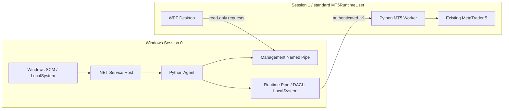

# MT5Agent v0.1.5 Release Readiness

**Current status (2026-10-14): PARTIAL — RELEASE INCOMPLETE.** Internal Release is published and all nine assets have been downloaded and hash-verified. The exact recovered Tag artifact #126 passed Windows installation, IPC, WPF basic smoke and a fresh 31/31-sample soak. Four relative documentation links in the immutable Release Notes resolve incorrectly in GitLab's Release context (DOC-REL-001); full closure is pending a traceable metadata correction. See the [final release report](../evidence/v0.1.5/V0.1.5_FINAL_RELEASE_REPORT.md).

## Exact published artifact — Pipeline #126

- Annotated Tag `v0.1.5` targets approved main `18ced8da8b9e39f8fb2d16df0ac0052b6161a1bf`; Tag object `37240c6877c6d8ad88591991195f1ed04e8f73e4`. The earlier Tag was recovered under the Product Owner's explicit exception; branch history was preserved.
- Main #125: 14/14 PASS. Tag #126: 15/15 PASS, including SYSTEM/Session-0 runtime smoke #1449 and internal Publisher #1454.
- Build #1452 / Verify #1453; Installer SHA-256 `f12ca6c63cef058b7fa8defbf4a7406f04d304c85f4161a8884ccd4a20359f85`; 22,454,757 bytes. Manifest, sidecar and 9/9 installed components agree.
- Fresh in-place installation on `win10-mt5-runner`: Installer PID3024, Exit0. Service PID3700 and Agent2456/4828 run as LocalSystem in Session0 after controlled restart. Worker4332/6276 and MT5 6168 remain under standard MT5RuntimeUser in Session1.
- Health is FRESH/MT5_CONNECTED and authenticated `worker_session_id=1`. Direct Administrator-to-Runtime and RuntimeUser-to-Management access remain denied. Bundled Worker executable was hash-verified; its execution is not claimed because the existing compatible Python Worker was preserved.
- Human Owner ID3 independently approved MR!12. New, unedited Note#39 was parsed and validated from the real HTTPS API. Earlier invalid/edited notes remain in the audit trail.
- Fresh soak: 31/31 PASS over 906.1 seconds, stable process trees, no product error events. WPF Session-1 launch and Close-to-Tray preserve Service/Worker/MT5.
- [Internal Release](https://gitlab.local/root/agent/-/releases/v0.1.5): nine permanent Generic Package assets, independently downloaded and hash-verified. GitHub Source Mirror matches the Tag; no GitHub Release or public binary asset was created.
- Documentation-only follow-up artifacts do not replace frozen #126. DOC-REL-001 affects four documentation URLs, not Installer integrity or runtime evidence; published files have not been silently replaced.

## Architecture and lifecycle

The product/Core/bundled Worker version is `0.1.5`; Desktop/Service metadata is `0.1.5.0`; pipe protocols remain v1. HTTPS and real independent Owner preparation are complete. Historical #98/#102 installations establish only their own exact binaries. Current release evidence is the exact Tag #126 installation and immutable Registry read-back; historical #112 evidence applies only to its previous bytes. See the [runbook](../releases/v0.1.5-release-unblock-runbook.md).

The Service starts the Agent in Session 0. The Management pipe serves only the
configured callers and read-only operations. The Worker and existing MT5
terminal run under the standard interactive runtime account. Runtime settings
are machine-local; the Worker pipe authorizes the actual LocalSystem Service
identity. No MT5 installation, profile, account or credential is managed by the
Installer.

## Historical acceptance snapshot — Pipeline #98

| Gate | Result | Evidence |
|---|---|---|
| Feature-branch CI | **PASS** | Pipeline #98, commit `54f47a6dad8541984b3930051cb6610f85bb95cc`, 14/14 required jobs passed, including `smoke:mt5-runtime` Job #1055. |
| Artifact provenance | **PASS** | Build #1058 / Verify #1059; Installer SHA-256 `409d930b46d16b17d546a1dd89a609d05d53447ecf12d4ce180fcf4e898320d4`; manifest and sidecar agree. |
| Exact artifact installation | **PASS** | Same Pipeline #98 artifact installed on `win10-mt5-runner`; final controlled run PID 5648, Exit Code 0. All 9 installed components match the manifest at their actual Inno destinations. |
| Service and Agent | **PASS** | Service LocalSystem, Automatic, Session 0; after controlled restart Service PID 3560 and Agent PIDs 3572/3364, both Session 0. Service is currently Running. |
| Worker and MT5 | **PASS for observed state** | Worker process tree PIDs 4332/6276 and MT5 PID 6168, all in Session 1 under `MT5RuntimeUser`; no duplicate terminal or Worker tree observed. |
| Secure IPC / authorization | **PASS for tested boundary** | Pipeline #98's SYSTEM smoke ran in Session 0 and used the configured runtime pipe; unauthorized Administrator-to-Worker access was denied. The installed Management client succeeded for an allowed Administrator and was denied for RuntimeUser. |
| Worker Session health | **PASS** | Live authenticated Management Health after installation and after Service restart reported `worker_session_id=1`, fresh health, `AGENT_RUNNING`, `WORKER_READY`, `MT5_CONNECTED`. |
| Clean stability soak | **PASS** | 31/31 samples over 901 seconds; all fresh and connected, correct Session ID, stable process topology, no unexpected restart. The operator-requested MT5 restart occurred before this clean interval and is not counted as a product failure. |
| WPF smoke | **PASS for launch/close-to-tray** | Installed Desktop launched visibly in Session 1 (PID 6032); closing to tray left Service, Worker and MT5 running. Full UI/accessibility/DPI coverage remains untested. |
| Public distribution | **BLOCKED** | Artifact is unsigned and internal. No release, tag, or merge to `staging`/`main` was performed. |

Detailed machine evidence, PID/session map, Installer attempts, hashes, timings,
and remaining untested gates are recorded in the linked report. Historical
Pipeline rows below remain as a diagnostic record; the current snapshot
supersedes their earlier pending/failing status where applicable.

## Acceptance evidence

| Gate | Result | Evidence / limitation |
|---|---|---|
| CI baseline | **PASS** | Pipeline #84 passed 14/14 jobs; Build #862 and Verify #863; commit `91d5f6b47181375dc76975ebf61081746d0d136b`. |
| Pipeline #84 artifact | **PASS** | Installer/manifest/sidecar match; Ubuntu and Windows SHA-256 `2606c179c2744cddda54915140f264029adac1a35c9b372596a586192d1927de`; 9 installed components match Job #862. |
| Installer exit contract | **NOT RECORDED** | Product Owner manually installed the artifact; the Installer PID and numeric Exit Code were not captured. We did not rerun Pipeline #84 Setup. |
| Service registration / Session 0 | **PASS** | `MT5Agent` Automatic, LocalSystem, Running. Initially PID 4088 (Agent 7236/7016), after controlled restart PID 2368 (Agent 8092/6544), and after VM power-on PID 2940 (Agent 3560/3696) were all observed in Session 0. |
| SCM recovery | **PASS** | Live readback: restart at 5 s and 15 s, 86,400 s reset, non-crash failures enabled (`TRUE`). |
| Runtime identity / pipe ACL | **PASS for tested boundary** | RuntimePrincipal is standard `MT5RuntimeUser`; ControlPrincipal migrated reversibly to LocalSystem using the packaged supported script. Administrator and RuntimeUser negative access attempts were denied; a LocalSystem health probe succeeded. |
| Worker / MT5 health | **PASS for initial Worker-only soak** | 32/32 health samples over 15m34s; Worker PID 6852 and MT5 PID 7944 stayed in Session 1, one Worker process, connected/initialized, terminal build 6249. Safe version and symbol-count reads passed. |
| Agent↔Worker↔MT5 | **PASS for tested live path** | The original clean soak passed 32/32 over 15m35s. After VM power-on, a second soak passed 32/32 fresh `MT5_CONNECTED` samples over 15m34s. Current Worker PID 6276 and terminal PID 7308 remained in Session 1 under `MT5RuntimeUser`, with the terminal parented by the Worker. Safe terminal version and symbol-count reads passed earlier. The earlier reconnect-exhausted interval after Worker API shutdown/restart is retained as a separate non-clean run and risk. |
| Management authorization | **PASS for tested boundary** | Authorized Administrator `status.get` succeeded; RuntimeUser access to Management and Administrator access to the Worker pipe were denied with WinError 5. The Service's LocalSystem identity was authorized for Worker IPC/health, not Management `status.get`. Contract probes as LocalSystem returned structured `TIMEOUT` and `UNSUPPORTED_OPERATION` for `service.restart`. Unsupported Worker `order_send` was rejected as `IPC_UNSUPPORTED_OPERATION`; no trade occurred. |
| Service restart preservation | **PASS** | Controlled Service restart returned to Running as LocalSystem/Automatic, with a fresh connected Management response. Service PID changed 4088→2368; Worker PID 7032 and MT5 PID 7944 were preserved. |
| Health contract (historical Pipeline #84) | **FIXED and deployed in Pipeline #98** | The authenticated Worker Session ID correction was included in the deployed source lineage; live Pipeline #98 Management Health reported `worker_session_id=1` while the Worker ran in Session 1. |
| CI for health fix | **FAIL — infrastructure** | Pipeline #85 Windows tests and WPF Management passed; its Windows and Worker builds failed on mirror timeouts. Pipelines #86 and #87 passed Windows tests, WPF Management, and Desktop package verification; Linux tests failed before test execution on the same mirror timeout, so downstream build/Installer jobs were skipped. No quality gate or package source was changed. |
| Pipeline #88 on commit `1c746bc39ecbb7b734169d9f12eb0733d5bc9b94` | **FAIL — CI identity precondition** | Windows validation, Desktop build/package validation, Linux/Windows/WPF tests, both builds, `smoke:control-plane`, `smoke:invalid-configuration`, and Desktop package verification passed. `smoke:mt5-runtime` failed closed at `Assert-WorkerTaskAndPreflight`: the self-hosted runner service runs as `WIN10-MT5-RUNNE\Administrator`, while the installed runtime policy sets `ControlPrincipal=NT AUTHORITY\SYSTEM`. The Session 0 control-caller SID check rejected the mismatch before runtime IPC. Windows packaging and both Installer jobs were skipped; no new artifact exists. Do not broaden the Worker pipe ACL or change ControlPrincipal to make this smoke pass. The CI smoke needs a supported way to run its control client as the configured Session 0 service identity. |
| Pipeline #89 on commit `27f994b7cf38c747831f6ae64147a1d508607bf3` | **FAIL — same identity precondition** | Doc-only pipeline repeated the failed Administrator-versus-LocalSystem check in `smoke:mt5-runtime` Job #929; no artifact was produced. This is the last observed Pipeline baseline. |
| Pipeline #90 on commit `caa7cfc20ebd374a400c29d511b56c7cc6d72819` | **FAIL — regression fixture mismatch** | Windows Job #937 ran 344 passed / 2 skipped / 1 failed. New package validation correctly requires `worker_session_id` to match the authenticated Worker session; the legacy isolated `test_package_preserves_single_validated_binary` fixture omitted that newly required field. The WPF Management job passed. Runtime smoke and packaging were not reached. Updated the fixture and added malformed/missing Session ID rejection cases before the next Pipeline. |
| Pipeline #91 on commit `479575e0f1bb25c4e3946a3c39f641810d38466f` | **FAIL — ACL preflight false positive** | Linux, Windows, WPF, Agent/Worker builds and degraded control-plane smoke passed; Windows test Job #951 passed. Live smoke Job #957 failed before creating the Scheduled Task because a composite Windows rights bitmask interpreted the installed `BUILTIN\Users:(RX)` ACE as writeable. A read-only ACL inspection (`icacls C:\Program Files\MT5Agent`) confirmed Users has only Read & Execute and TrustedInstaller/System/Admin have Full Control. The ACL was not changed. Replaced the overlapping composite mask with per-right checks and added a regression guard; retry pending. |
| Pipeline #92 on commit `1b96f2e4fd90e4dfdee07fe471db24d8f4d7edad` | **FAIL — inherited ACE translation** | All prior validation/test/build jobs passed. Live smoke Job #971 failed before Scheduled Task creation while translating the `CREATOR OWNER` inheritance-only ACE. No ACL or installed component changed. The coordinator now ignores `InheritOnly` ACEs when checking the root's effective access and fails closed if any other effective mutating ACE cannot be resolved. Another real Windows run is required. |
| Pipeline #93 on commit `468ccaebc585467dc3f19edbf099169434b38f70` | **FAIL — candidate version command** | All Windows tests and builds passed. Live smoke Job #985 passed ACL preflight and reached the Scheduled Task action. Captured candidate stdout was `0.1.3`; its `--version` command nevertheless failed the exit/output contract. The smoke did not reach Worker IPC. The task was removed, the temporary stage was cleaned, and `schtasks /Query /TN MT5AgentRuntimeSmoke_93_985` confirmed it absent. Raw structured task results were not copied by the failure path; the coordinator now preserves that receipt and prints the candidate exit code/output for the next diagnostic run. |
| Protected LocalSystem smoke implementation | **PASS in Pipeline #98** | Job #1055 used a protected one-shot SYSTEM Scheduled Task in Session 0, fixed allowlisted operations, integrity/identity checks, bounded execution, serialized runtime access, structured receipt, and owned-resource cleanup. See [`CI_RUNTIME_SMOKE.md`](CI_RUNTIME_SMOKE.md). |
| WPF Management test executable provenance | **PASS in Pipeline #98** | Job #1055 validated the same-pipeline test executable receipt and copied executable hash before the authorized Management probe. |
| Source Worker Session health correction | **PASS in regression and live installed artifact** | The adapter reports the authenticated Worker's positive session ID, not a runtime-supplied health field. The exact Pipeline #98 Installer is installed and live health reports Session 1. |
| Local Python regression for current changes | **PASS with host-only exclusion** | `pytest`: 302 passed, 37 skipped; `tests/test_windows_worker_launcher.py` was excluded because `pywin32` is unavailable on Ubuntu. Windows CI must execute the complete configured suite. |
| Logs / event review | **PASS for observed window** | One informational MT5Agent Application event and one SCM Information event after installation/configuration; no matching .NET Runtime/Application Error or MT5Agent error event found. Logs redact SIDs and expose fixed messages. |
| WPF on integration runner | **PASS for basic smoke; broader UX checks not tested** | Pipeline #98 Desktop launched visibly in Session 1 and closed to tray without stopping Service/Worker/MT5. Accessibility, high DPI, keyboard navigation, dashboard/settings/log views were not exhaustively checked. |
| Windows 11 / Server compatibility | **NOT TESTED** | Live product evidence is Windows 10 Pro x64 build 19045 only. |
| RDP/logoff, Worker-unavailable injection | **NOT TESTED** | These tests were not performed to preserve the active session and MT5 runtime. |
| Public release / signing | **BLOCKED** | Internal unsigned artifact; no release, tag, or merge to staging/main. |

Detailed live evidence is in
[`win10-mt5-runner-runtime-integration-20261013.md`](../evidence/v0.1.5/win10-mt5-runner-runtime-integration-20261013.md).
Raw evidence remains under
`C:\MT5Agent-Test\Evidence\RuntimeIntegration-Pipeline84-Install-20261013-151000\`.

## Release decision

Internal publication and the exact #126 operational gates PASS. Overall closure is **PARTIAL — RELEASE INCOMPLETE** while DOC-REL-001 remains open. The Release is INTERNAL / PRE-PRODUCTION and UNSIGNED — NOT APPROVED FOR PUBLIC DISTRIBUTION. Four source documentation URLs are corrected in the follow-up; immutable published metadata requires an explicit, auditable correction before CLOSED can be declared.

Windows 11 and Server 2022/2025, reboot/RDP/logoff, live Worker-crash injection, exhaustive WPF/DPI/accessibility/settings and uninstall remain NOT TESTED for this artifact. These limitations remain distinct from the tested Windows 10 scope. The operator-directed MT5 restart for fresh prices is not a product defect. The actual scope, accepted KI-009 risk, metrics and evidence paths are in the final report.
