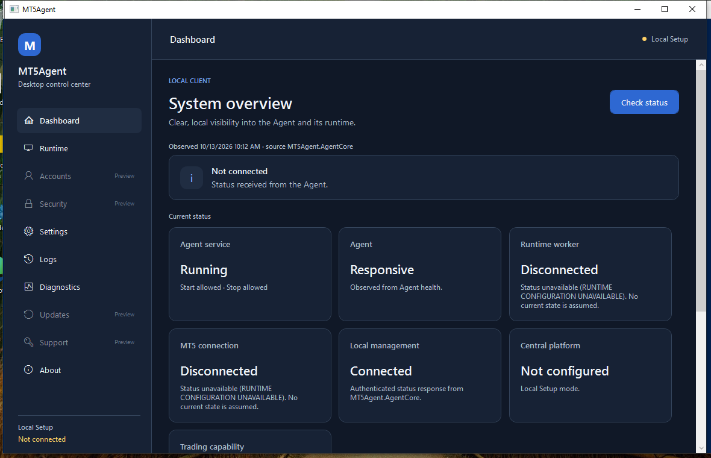

# MT5Agent v0.1.5 — Pipeline 82 Windows 10 Installation Evidence

**Result: PARTIAL because Worker/MT5 provisioning and several platform/lifecycle checks remain incomplete.** The 15-minute stability sample and one controlled recovery cycle completed. This is evidence for an internal candidate, not a public release. CI success is not treated as proof of a Windows installation; the observations below were collected from the dedicated `WIN10-INSTALLER` VM.

## Artifact and provenance

| Field | Verified value |
|---|---|
| Pipeline / build / verify | #82 / #834 / #835; all 14 pipeline jobs passed |
| Source commit | `bb7928643ed5f45ecd70afbad032d88ef833a034` |
| Installer | `MT5Agent-Setup-v0.1.5-windows-x64.exe`, 22,459,348 bytes |
| SHA-256 | `5578546e223cec3d23f8d25e78a6e0d1d62af7c0f04db13b26255b9184b39404` |
| Manifest and sidecar | Commit, pipeline, build job, filename, size and SHA-256 all match the executable |
| Host verification | Ubuntu and Windows SHA-256 values match; installed component hashes match the manifest after mapping Support files to the installed `maintenance` directory |
| Signing | Unsigned internal artifact; not approved for public distribution |

The authenticated artifact archive was downloaded from Build #834. Two browser temporary files had identical SHA-256 and passed ZIP integrity checks; the installer, manifest and sidecar extracted from that archive matched the verifier provenance and each other. The installer binary was not run until its SHA-256 had also matched on Windows.

## Preflight and installation

- Windows 10 Pro x64, build 19045; hostname `WIN10-INSTALLER`; elevated `WIN10-INSTALLER\Administrator`.
- C: had 39.24 GiB free. No concurrent MT5Agent Installer process was present. Existing MT5Agent Service and product files from earlier test pipelines were retained and repaired by the install; this was not a clean-machine install.
- Existing MT5 `terminal64.exe` remained present; no MT5 terminal process was running. Pending Windows Update/CBS reboot indicators and pre-existing Edge Update/spooler rename entries were recorded. No reboot or snapshot operation was performed.
- One Installer execution: PID `4912`, Exit Code `0`, 17.766 seconds, started `2026-10-13 10:06:01 +03:30`, ended `10:06:19 +03:30`. Arguments: `/VERYSILENT /SUPPRESSMSGBOXES /SP- /NORESTART /NOCLOSEAPPLICATIONS` with an absolute log path.
- Installer log: `C:\MT5Agent-Test\Evidence\Install-Pipeline82-Retest-20261013-100449\installer.log`. Service install log: `C:\ProgramData\MT5Agent\Logs\service-install.log`.

## Service, Agent and Management IPC

- SCM registered `MT5Agent`, Auto Start, LocalSystem, executable `C:\Program Files\MT5Agent\Service\MT5Agent.Service.exe`. After install, service PID `7268` and Agent parent/child PIDs `4712`/`8884` were in Session 0. After the controlled lifecycle check, service PID `2268` and Agent parent/child PIDs `5584`/`5640` were again in Session 0.
- SCM read back the two bounded restart actions (5 s and 15 s), 24-hour reset period, and `FAILURE_ACTIONS_ON_NONCRASH_FAILURES: TRUE`.
- A controlled stop of the newly installed Pipeline #82 service completed in 1.891 s. The Agent logged shutdown in progress and host stopped; no MT5Agent process remained after stop. Service restart reached Running in 4.641 s. This validates the shutdown-event fix in the installed build. During the Installer upgrade itself, the previous Pipeline #80 Service binary logged its existing 8-second graceful-shutdown timeout; the new binary later stopped cleanly in the explicit lifecycle test.
- A controlled Agent parent-process termination (PID `5584`) was detected as an unexpected child exit. SCM automatically recovered the Service with new PID `8868` in 12.61 s; the Agent parent/child restarted in Session 0. A fresh Management status request then succeeded. This verifies one recovery cycle; repeated crash and boot recovery were not tested.
- Authorized Administrator `status.get` and `logs.query` requests succeeded. Status was fresh and reported Agent Core version `0.1.3`, `AGENT_RUNNING`, `RUNTIME_CONFIGURATION_UNAVAILABLE`, Worker disconnected, MT5 disconnected, and trading unavailable. The Desktop reports product version `0.1.5.0`; the packaged Agent Core component retains its `0.1.3` version. The missing runtime was not reported as healthy.
- A LocalSystem probe received `UNAUTHORIZED`; an unsupported `service.restart` Management operation received `UNSUPPORTED_OPERATION`. The Management pipe was present and no listener existed on loopback TCP port 8080. Logs redacted caller SIDs; the reviewed product logs contained no credential-like fields.
- A client that connected but sent no request received a structured `TIMEOUT` error after the server deadline; a subsequent `logs.query` succeeded and the Service remained Running.
- Windows Application events from provider `MT5Agent` reported informational service start/stop. No .NET Runtime or Application Error event was observed in the post-install review. Service Host evidence: `C:\ProgramData\MT5Agent\Logs\service-host.log`; Agent log: `C:\ProgramData\MT5Agent\Logs\agent.stderr.log`.

## Worker, MT5 and WPF

- Worker status: **NOT CONFIGURED**. The packaged Worker binary is installed, but `HKLM\SOFTWARE\MT5Agent\Runtime`, a configured standard runtime principal, and the interactive Worker task are absent. The supported configuration requires a dedicated non-administrator user and a matching MT5 profile `origin.txt`. No account, password, profile, MT5 installation, or trading data was changed to manufacture a test configuration.
- MT5 installation path remained present; zero `terminal64.exe` processes were observed. No trade was attempted. Worker-to-Agent IPC, MT5 initialization, reconnection, RDP disconnect and logoff therefore remain untested.
- Installed Desktop version `0.1.5.0`, SHA-256 `1fa69532a0c940642910792bdda1f90a8eed2a13548daf2cdce6107657703326`; Start Menu shortcut points to the installed executable. WPF launched in interactive Session 1, opened Runtime, Settings, Logs, Diagnostics and About, and returned current Agent/Worker/MT5 status. Theme was toggled twice and restored; saved preferences were restored byte-for-byte (or their original absence was restored). UI exited normally while Service PID `2268` remained Running.
- The session's display scaling was not changed. High-DPI scaling, screen-reader testing and tray-menu invocation were not verified here.

## Stability and remaining gates

The installed Service remained Running through 32 samples over 987 seconds. Service PID stayed `2268` (zero Service PID changes); the Agent process PID set stayed constant; product process count remained three (Service host and Agent parent/child). Sampled per-process cumulative CPU values ranged from 0.016 to 0.078 seconds and the observed Working Set range was 4.71–26.15 MiB. No listener appeared on port 8080 and no .NET Runtime/Application Error event was found during the sample. After the soak, the one controlled Agent termination above recovered automatically. Repeated crash behavior, reboot, RDP disconnect and logoff were not tested.

Windows 11 and Windows Server compatibility remain **NOT TESTED**. The Windows 10 installation, Session 0 Service startup, Agent health, authorized and rejected Management requests, installed WPF smoke, Service recovery settings, 987-second stability sample and one automatic recovery cycle have real VM evidence. The release remains **PARTIAL** until a separately provisioned Worker/MT5 interactive runtime and the untested lifecycle/platform checks satisfy the applicable gates. No merge, tag, public release or real trade was performed.

## Raw evidence location

Full timestamped evidence was preserved on the test VM at:

`C:\MT5Agent-Test\Evidence\Install-Pipeline82-Retest-20261013-100449\`

The evidence set includes the preflight, artifact integrity, installer execution and log, Service installation and lifecycle records, component hashes, authorized and unauthorized IPC responses, WPF UI Automation report and screenshot, SCM/Application events, and 15-minute stability samples. Earlier evidence directories were retained.
